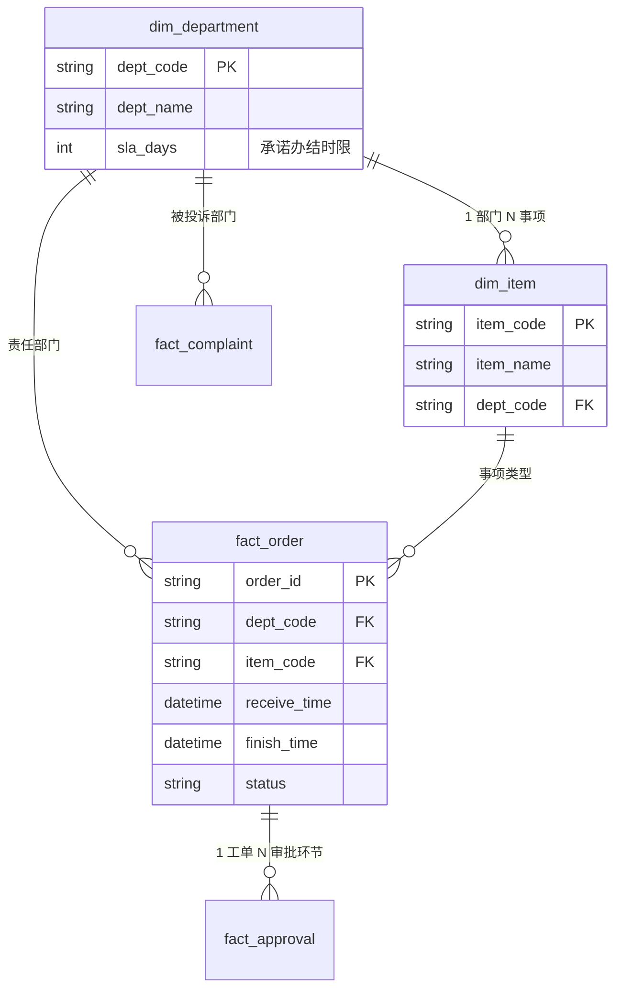

# 数据库设计文档（MySQL 8.0）

> 项目：政务民生大数据统计与便民服务平台
> 版本：V1.0・2026-10-11
> 说明：本文件为「数据生成 → 清洗 → 入库」的唯一设计依据，generator /cleaner/stats 代码按此实现。


***

## 1. 选型与连接


| 项         | 决定                                                                                |
| --------- | --------------------------------------------------------------------------------- |
| 数据库       | 本地 MySQL 8.x（3306 已确认监听）                                                          |
| Python 连接 | `pymysql` + 连接上下文管理（不引入 ORM，项目规模小，原生 SQL 参数化更可控）                                  |
| 库名        | `minzheng`                                                                        |
| 字符集       | `utf8mb4` / `utf8mb4_unicode_ci`（中文无乱码）                                           |
| 引擎        | InnoDB（外键约束生效）                                                                    |
| 数据源分层     | Faker 原始脏数据先落 `data/raw/*.csv`（留档）→ cleaner 清洗后写入 MySQL（`fact_*` 表）→ API 只读 MySQL |

`config.py` 连接配置（密码从环境变量读，不硬编码）：


```
DB\_CONFIG = {

&#x20;   "host": "localhost",

&#x20;   "port": 3306,

&#x20;   "user": "root",                 # 待确认：实际账号

&#x20;   "password": os.getenv("MYSQL\_PASSWORD", ""),  # 待确认

&#x20;   "database": "minzheng",

&#x20;   "charset": "utf8mb4",

}
```


***

## 2. ER 关系总览





* **6 张表**：2 张字典表（`dim_department`、`dim_item`）+ 4 张事实表（`fact_order`、`fact_approval`、`fact_consult`、`fact_complaint`）。

* 事实表之间：工单是主表，审批表挂工单；咨询 / 投诉独立成表（不挂工单，模拟热线与大厅投诉）。


***

## 3. 建库与建表 DDL


```
\-- ========== 0. 建库 ==========

CREATE DATABASE IF NOT EXISTS minzheng

&#x20; DEFAULT CHARACTER SET utf8mb4

&#x20; COLLATE utf8mb4\_unicode\_ci;

USE minzheng;

\-- ========== 1. 部门字典 ==========

CREATE TABLE IF NOT EXISTS dim\_department (

&#x20; dept\_code       VARCHAR(8)   NOT NULL COMMENT '部门编码（主键）',

&#x20; dept\_name       VARCHAR(32)  NOT NULL COMMENT '部门全称',

&#x20; dept\_short      VARCHAR(16)  NOT NULL COMMENT '部门简称',

&#x20; sla\_days        INT          NOT NULL DEFAULT 10 COMMENT '承诺办结时限（工作日），用于超时判定',

&#x20; workload\_weight DECIMAL(3,2) NOT NULL DEFAULT 1.00 COMMENT '工单量生成权重（仅生成器用）',

&#x20; satisfaction\_bias DECIMAL(3,2) NOT NULL DEFAULT 0.00 COMMENT '满意度偏差（生成器用，可正可负）',

&#x20; PRIMARY KEY (dept\_code)

) ENGINE=InnoDB DEFAULT CHARSET=utf8mb4 COMMENT='部门字典';

\-- ========== 2. 事项字典 ==========

CREATE TABLE IF NOT EXISTS dim\_item (

&#x20; item\_code      VARCHAR(8)   NOT NULL COMMENT '事项编码（主键）',

&#x20; item\_name      VARCHAR(48)  NOT NULL COMMENT '事项名称',

&#x20; dept\_code      VARCHAR(8)   NOT NULL COMMENT '归属部门',

&#x20; avg\_materials  INT          NOT NULL DEFAULT 3 COMMENT '平均材料数（生成器用）',

&#x20; complexity     DECIMAL(3,2) NOT NULL DEFAULT 1.00 COMMENT '复杂度系数（影响办结时长，生成器用）',

&#x20; PRIMARY KEY (item\_code),

&#x20; KEY idx\_item\_dept (dept\_code),

&#x20; CONSTRAINT fk\_item\_dept FOREIGN KEY (dept\_code)

&#x20;   REFERENCES dim\_department (dept\_code)

) ENGINE=InnoDB DEFAULT CHARSET=utf8mb4 COMMENT='事项字典';

\-- ========== 3. 工单主表（清洗后） ==========

CREATE TABLE IF NOT EXISTS fact\_order (

&#x20; order\_id        VARCHAR(20)  NOT NULL COMMENT '工单号：GW+YYYYMMDD+4位序号',

&#x20; citizen\_name    VARCHAR(20)  NOT NULL COMMENT '申请人姓名（Faker 模拟，非真人）',

&#x20; citizen\_masked  VARCHAR(20)  NOT NULL COMMENT '脱敏证件号，如 6101\*\*\*\*\*\*\*\*1234',

&#x20; item\_code       VARCHAR(8)   NOT NULL COMMENT '事项编码',

&#x20; dept\_code       VARCHAR(8)   NOT NULL COMMENT '责任部门',

&#x20; channel         VARCHAR(8)   NOT NULL COMMENT '办理渠道：online 线上 / window 窗口 / self 自助',

&#x20; receive\_time    DATETIME     NOT NULL COMMENT '受理时间',

&#x20; finish\_time     DATETIME     NULL     COMMENT '办结时间（在办/废弃件为 NULL）',

&#x20; status          VARCHAR(10)  NOT NULL COMMENT '状态：done 已办结 / doing 在办 / timeout 超时 / abandoned 废弃 / returned 退件',

&#x20; is\_appointment  TINYINT(1)   NOT NULL DEFAULT 0 COMMENT '是否预约：1 是 0 否',

&#x20; materials\_count INT          NULL     COMMENT '提交材料数（允许 NULL 缺失）',

&#x20; handler         VARCHAR(20)  NOT NULL COMMENT '经办人',

&#x20; duration\_days   DECIMAL(6,2) NULL     COMMENT '办结时长（自然日，清洗后计算）',

&#x20; is\_timeout      TINYINT(1)   NOT NULL DEFAULT 0 COMMENT '是否超时件：1 是 0 否（清洗后按部门 sla 判定）',

&#x20; dq\_flag         VARCHAR(20)  NULL     COMMENT '数据质量标记：duplicate 重复 / abnormal\_dur 异常时长 / NULL 正常',

&#x20; PRIMARY KEY (order\_id),

&#x20; KEY idx\_order\_dept (dept\_code),

&#x20; KEY idx\_order\_status (status),

&#x20; KEY idx\_order\_receive (receive\_time),

&#x20; KEY idx\_order\_dept\_status (dept\_code, status),

&#x20; CONSTRAINT fk\_order\_item FOREIGN KEY (item\_code) REFERENCES dim\_item (item\_code),

&#x20; CONSTRAINT fk\_order\_dept FOREIGN KEY (dept\_code) REFERENCES dim\_department (dept\_code)

) ENGINE=InnoDB DEFAULT CHARSET=utf8mb4 COMMENT='办事工单（清洗后）';

\-- ========== 4. 审批记录 ==========

CREATE TABLE IF NOT EXISTS fact\_approval (

&#x20; approval\_id  VARCHAR(24) NOT NULL COMMENT '审批单号：AP+工单后8位+环节',

&#x20; order\_id     VARCHAR(20) NOT NULL COMMENT '所属工单',

&#x20; approver     VARCHAR(20) NOT NULL COMMENT '审批人',

&#x20; step         VARCHAR(12) NOT NULL COMMENT '环节：accept 受理 / review1 初审 / review2 复核 / finish 办结',

&#x20; result       VARCHAR(8)  NOT NULL COMMENT '结果：pass 通过 / return 退回',

&#x20; approve\_time DATETIME    NOT NULL COMMENT '审批时间',

&#x20; PRIMARY KEY (approval\_id),

&#x20; KEY idx\_appr\_order (order\_id),

&#x20; CONSTRAINT fk\_appr\_order FOREIGN KEY (order\_id) REFERENCES fact\_order (order\_id)

) ENGINE=InnoDB DEFAULT CHARSET=utf8mb4 COMMENT='审批记录';

\-- ========== 5. 咨询记录 ==========

CREATE TABLE IF NOT EXISTS fact\_consult (

&#x20; consult\_id   VARCHAR(20) NOT NULL COMMENT '咨询单号：CS+YYYYMMDD+序号',

&#x20; channel      VARCHAR(10) NOT NULL COMMENT '渠道：hotline 热线 / online 在线 / window 窗口',

&#x20; topic        VARCHAR(20) NOT NULL COMMENT '主题：policy 政策 / process 流程 / material 材料 / progress 进度',

&#x20; is\_resolved  TINYINT(1)  NOT NULL DEFAULT 1 COMMENT '是否解决：1 是 0 否',

&#x20; satisfaction TINYINT     NULL     COMMENT '回访满意度 1-5（允许 NULL）',

&#x20; consult\_time DATETIME    NOT NULL COMMENT '咨询时间',

&#x20; PRIMARY KEY (consult\_id),

&#x20; KEY idx\_consult\_time (consult\_time)

) ENGINE=InnoDB DEFAULT CHARSET=utf8mb4 COMMENT='咨询记录';

\-- ========== 6. 投诉记录 ==========

CREATE TABLE IF NOT EXISTS fact\_complaint (

&#x20; complaint\_id   VARCHAR(20) NOT NULL COMMENT '投诉单号：TS+YYYYMMDD+序号',

&#x20; type           VARCHAR(12) NOT NULL COMMENT '类型：efficiency 效率 / attitude 态度 / process 流程 / other 其他',

&#x20; dept\_code      VARCHAR(8)  NOT NULL COMMENT '被投诉部门',

&#x20; status         VARCHAR(10) NOT NULL COMMENT '状态：done 已处理 / doing 处理中',

&#x20; handle\_days    DECIMAL(5,1) NULL    COMMENT '处理天数（处理中为 NULL）',

&#x20; satisfaction   TINYINT     NULL     COMMENT '回访满意度 1-5（允许 NULL）',

&#x20; complaint\_time DATETIME    NOT NULL COMMENT '投诉时间',

&#x20; PRIMARY KEY (complaint\_id),

&#x20; KEY idx\_comp\_dept (dept\_code),

&#x20; KEY idx\_comp\_time (complaint\_time),

&#x20; CONSTRAINT fk\_comp\_dept FOREIGN KEY (dept\_code) REFERENCES dim\_department (dept\_code)

) ENGINE=InnoDB DEFAULT CHARSET=utf8mb4 COMMENT='投诉记录';
```


***

## 4. 字典种子数据


```
\-- 部门（10 个）

INSERT INTO dim\_department

&#x20; (dept\_code, dept\_name, dept\_short, sla\_days, workload\_weight, satisfaction\_bias) VALUES

&#x20; ('HR','人力资源和社会保障局','人社局',   10, 1.20,  0.10),

&#x20; ('SB','社会保险基金管理中心',  '社保中心', 5,   2.50, -0.20),

&#x20; ('YL','医疗保障局',          '医保局',   15,  1.80, -0.30),

&#x20; ('GA','公安局政务窗口',       '公安窗口', 12,  1.50,  0.00),

&#x20; ('SC','市场监督管理局',       '市场监管', 10,  1.00,  0.10),

&#x20; ('SW','税务局',              '税务局',   7,   0.90,  0.20),

&#x20; ('JW','住房和城乡建设局',     '住建局',   20,  0.50, -0.10),

&#x20; ('BD','不动产登记中心',       '不动产',   15,  2.00, -0.50),

&#x20; ('GJ','住房公积金管理中心',   '公积金',   8,   0.80,  0.00),

&#x20; ('WS','卫生健康委员会',       '卫健委',   10,  0.40,  0.00);

\-- 事项（20 个）

INSERT INTO dim\_item

&#x20; (item\_code, item\_name, dept\_code, avg\_materials, complexity) VALUES

&#x20; ('SB01','社保参保登记',     'SB', 4, 1.00),

&#x20; ('SB02','社保缴费证明',     'SB', 2, 0.40),

&#x20; ('SB03','养老资格认证',     'SB', 1, 0.30),

&#x20; ('YL01','医保报销',         'YL', 5, 1.30),

&#x20; ('YL02','生育登记',         'YL', 3, 0.70),

&#x20; ('YL03','异地就医备案',     'YL', 3, 0.90),

&#x20; ('HR01','失业登记',         'HR', 2, 0.60),

&#x20; ('HR02','工伤认定',         'HR', 6, 1.60),

&#x20; ('GA01','户籍迁移',         'GA', 5, 1.20),

&#x20; ('GA02','居住证办理',       'GA', 3, 0.80),

&#x20; ('SC01','营业执照设立',     'SC', 4, 1.10),

&#x20; ('SC02','变更登记',         'SC', 2, 0.60),

&#x20; ('SW01','税务申报',         'SW', 2, 0.70),

&#x20; ('SW02','发票代开',         'SW', 1, 0.30),

&#x20; ('JW01','建设工程竣工验收', 'JW', 8, 2.00),

&#x20; ('GJ01','公积金提取',       'GJ', 3, 0.80),

&#x20; ('GJ02','公积金贷款',       'GJ', 6, 1.80),

&#x20; ('BD01','不动产登记',       'BD', 7, 1.90),

&#x20; ('BD02','抵押注销',         'BD', 3, 0.90),

&#x20; ('WS01','生育服务证',       'WS', 2, 0.50);
```


***

## 5. 数据质量埋点与清洗口径


| 埋点     | 比例    | 处理规则（cleaner.py）                                                             |
| ------ | ----- | ---------------------------------------------------------------------------- |
| 受理时间缺失 | \~5%  | **剔除**（无法计算时长，不进入 fact\_order）                                               |
| 重复工单   | \~3%  | 同 `citizen_masked + item_code + 同一天` 判重，保留最早一条，其余打 `dq_flag='duplicate'` 不入库 |
| 废弃件    | \~4%  | `status='abandoned'`，**不进 fact\_order**，留档 CSV                               |
| 异常时长   | \~2%  | `duration_days < 0.05` 或 `> 30`，打 `dq_flag='abnormal_dur'`，入库但统计默认排除         |
| 材料数缺失  | \~8%  | 保留 `NULL`，统计时 `COALESCE(AVG, 部门均值)` 兜底                                       |
| 满意度缺失  | \~10% | 保留 `NULL`，满意度均值计算 `WHERE satisfaction IS NOT NULL`                           |
| 业务规律   | —     | 周末 / 节假日受理量 ×0.3；月末（25–月底）办件量 ×1.5；按部门 workload\_weight 分配                   |

**超时判定口径（is\_timeout）**：


```
duration\_days > sla\_days × 1.4   （1 个工作日 ≈ 1.4 个自然日）
```

仅对 `status='done'` 的工单计算；`doing/timeout` 状态单独标记。


***

## 6. 关键指标 SQL 口径（stats 层直接复用）


```
\-- 总览

SELECT

&#x20; COUNT(\*)                                              AS total\_orders,

&#x20; AVG(status='done')                                    AS done\_rate,

&#x20; AVG(is\_timeout)                                       AS timeout\_rate,

&#x20; AVG(duration\_days)                                    AS avg\_duration\_days

FROM fact\_order

WHERE status IN ('done','timeout') AND dq\_flag IS NULL;

\-- 部门对比

SELECT o.dept\_code, d.dept\_short,

&#x20;      COUNT(\*)        AS cnt,

&#x20;      AVG(o.status='done')  AS done\_rate,

&#x20;      AVG(o.duration\_days)  AS avg\_dur,

&#x20;      AVG(o.is\_timeout)     AS timeout\_rate

FROM fact\_order o JOIN dim\_department d ON o.dept\_code=d.dept\_code

WHERE o.dq\_flag IS NULL

GROUP BY o.dept\_code;

\-- 满意度（咨询+投诉合并）

SELECT AVG(satisfaction) FROM (

&#x20; SELECT satisfaction FROM fact\_consult WHERE satisfaction IS NOT NULL

&#x20; UNION ALL

&#x20; SELECT satisfaction FROM fact\_complaint WHERE satisfaction IS NOT NULL

) t;
```


***

## 7. 待确认（开工前需要）


1. **MySQL 账号密码**：默认假设 `root` + 环境变量 `MYSQL_PASSWORD`；如你给我账号密码，我写进本地配置并跑通建库。

2. 数据规模：默认 **3 个月、工单 3 万条**（咨询 1.5 万、投诉 2000、审批约 6 万条），可在 `config.py` 改。

3. 是否需要单独留一张「废弃件归档表」（`fact_order_abandoned`）？默认方案：废弃件只留 CSV 不进 MySQL，保持库干净。